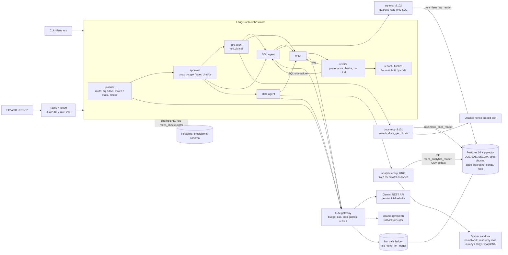

# RFLens

RFLens lets a wireless engineer ask plain-English questions across public RF data (FCC cellular
licences and equipment-authorization records, 3GPP user-equipment specifications, and the UCI SECOM
semiconductor manufacturing dataset) and get an answer in which every number, quotation and
citation is traced to the SQL rows, specification passages or statistical results it came from.
LangGraph agents reach the data only through three MCP servers (sql-mcp, docs-mcp, analytics-mcp) over
Postgres with pgvector. It is a public-data analogue of an internal smart-data-ecosystem problem and
uses no proprietary data. It is a personal project that runs on one machine; it is not endorsed,
certified or reviewed by the FCC or 3GPP, and the FCC data it loads is a snapshot, not current.

Status: v1, closed. 48 of 55 golden questions answered correctly in the last end-to-end run (one run
per question, temperature 0; details and caveats under Results).

## Contents

[Architecture](#architecture) · [Data sources](#data-sources) · [Results](#results) ·
[Engineering decisions](#key-engineering-decisions) · [Known limitations](#known-limitations) ·
[Not pursued](#not-pursued) · [Future work](#future-work) · [Quickstart](#quickstart) · [Demo](#demo)

## Architecture



The model calls of one question are the planner (1), the SQL agent (at most 3 generations), the stats
agent (at most 2) and the writer (at most 3 drafts). The doc agent, the verifier and the Sources section
make no model call. Agents never connect to Postgres; the only direct connection of the graph is its
checkpointer. Design documents: [docs/design/orchestrator.md](docs/design/orchestrator.md) and
[docs/design/analytics.md](docs/design/analytics.md).

## Data sources

| Data | Source | Licence as recorded in the `data_sources` table | Loaded |
|---|---|---|---|
| FCC ULS licences, cellular service (`l_cell.zip`, snapshot dated 2026-10-18) | `data.fcc.gov/download/pub/uls/complete/l_cell.zip` | US Government Work. The licence comes from the data.gov catalogue record; the FCC's own terms page answered 403 to automated requests, so it was not read. | 5,464 HD rows (licences and spectrum leases), 236,958 frequency rows, 25,145 location rows |
| FCC equipment-authorization grantees and accredited test firms | `opendata.fcc.gov` datasets `3b3k-34jp` and `nubx-v54a` | "Public Domain U.S. Government" on the dataset pages | 50,153 grantees, 591 test firms. Last updated 2021-03-22; contact data and street addresses are not loaded |
| UCI SECOM semiconductor manufacturing data | UCI Machine Learning Repository, dataset 179 | CC BY 4.0 (McCann & Johnston, 2008) | 1,567 runs, 590 features, 924,530 measurements (41,951 are missing values) |
| 3GPP TS 36.101 V19.6.0 and TS 38.101-1 V19.7.0 (Release 19) | 3GPP FTP host | Copyrighted by 3GPP/ETSI. Kept only under the gitignored `data/` and in the local database; nothing from 3GPP is in this repository | 4,359 + 2,502 chunks, all embedded; 141 operating-band rows parsed into `spec_operating_bands` |

The repository holds code, migrations, design documents, the golden question file and a small ULS
fixture. It holds no downloaded data. The loaders record each source's URL, licence and access date in `data_sources`, and the SHA-256 of
the downloaded files in its notes.

## Results

All numbers below come from [eval/RESULTS.md](eval/RESULTS.md). Every end-to-end figure is a single run
per question at temperature 0 on `gemini-3.1-flash-lite` (standard tier), scored by `make eval-e2e`.

### End-to-end score history

The golden set grew from 51 to 55 questions when the four stats questions were added, so the totals of
different rows are not comparable. The last column counts only the original 51.

| run | questions | correct | on the original 51 | cost |
|---|---|---|---|---|
| eval-e2e-fc0ac320 (baseline) | 51 | 37/51 | 37/51 | $0.088257 |
| eval-e2e-559aacfa (improvement round) | 51 | 44/51 | 44/51 | $0.098628 |
| eval-e2e-aecd54a7 (stats route added) | 55 | 44/55 | 41/51 | $0.111920 |
| eval-e2e-94d99ed1 (routing and prompt fixes) | 55 | 46/55 | 43/51 | $0.109840 |
| eval-e2e-d7222d07 (multi-query retrieval) | 55 | 48/55 | 44/51 | $0.100019 |

On the original 51 questions the latest run equals the 44/51 run: it fixed doc-01 and doc-22 and
broke doc-04 and doc-14. The extra 4 points over 44/51 are the 4 stats questions. Between runs on the
same 51 questions the total moved between 41 and 44 while prompts were changing.

Latest run (eval-e2e-d7222d07):

| type | correct | | author | correct |
|---|---|---|---|---|
| sql | 17/19 | | human | 28/30 |
| doc | 18/22 | | assistant | 20/25 |
| mixed | 3/4 | | | |
| stats | 4/4 | | | |
| refuse | 6/6 | | | |

It made 135 model calls (2.45 per question, 135 / 55) for $0.100019, which is $0.001819 per question on
average ($0.100019 / 55); the dearest single question cost $0.004302. The total spent on all model calls of the
project, from the ledger, is $0.738142 of a $2.50 cap.

### Retrieval and SQL evals

- Retrieval recall@5 (`make eval-docs`, question text through docs-mcp, run eval-docs-142b06d0, vector
  mode, without / with the spec filter): human questions 9/10 and 9/10, assistant questions 8/12 and
  8/12. Keyword search found 0/10 and 1/12 without the filter; the orchestrator uses vector search.
- The doc agent searches with both the planner's rewritten query and the user's question, merged by
  reciprocal rank fusion. Using the planner queries of three saved runs, the merged search found as many
  as the better single query in both author groups every time and never more (table in
  [docs/design/orchestrator.md](docs/design/orchestrator.md)).
- SQL agent on the golden SQL questions (`make eval-sql`, temperature 0): 19/19 in eval-sql-fd8d24a7.
  The first SQL run (14/14) is flagged in RESULTS.md as overstated, because its references counted
  spectrum leases as licences.

### How the golden set was built

55 questions in [eval/golden.yaml](eval/golden.yaml): 19 sql, 22 doc, 4 mixed, 4 stats, 6 refuse. 30 were
written and reviewed by the project owner (17 sql, 10 doc, 3 refuse). 25 were drafted by the AI
assistant (2 sql, 12 doc, 4 mixed, 4 stats, 3 refuse) and reviewed by the owner; all 55 have status
`reviewed`. SQL and mixed references are stored results of a reference query run through sql-mcp; doc
questions name an expected clause or table; stats references are computed by
`analytics_runner/reference.py`, which shares no code with the analyses. The improvement rounds were
designed from baseline misses, so no author group is untouched by tuning, and two stats reference
labels (stats-02 and stats-03) were edited after a run showed them over-specified.

## Key engineering decisions

- **The verifier checks provenance, not meaning.** It checks where each number, unit, quotation and
  citation comes from (a SQL cell, a cited chunk, an analysis result) and that stated sample sizes
  belong to the test; it does not check that the SQL asked the right question. Live example: a query
  once used a downlink edge for an uplink question, which the verifier could not see.
- **Band edges are joined, not typed.** Operating-band frequency ranges are parsed from the specs into
  `spec_operating_bands`, SQL joins that table, and the answer cites the chunk that holds the row.
- **Spectrum leases are detected.** 3,174 of the 5,464 ULS header rows are leases, not licences
  (`v_uls_licences.is_lease`), found from the file layout and the lease link records.
- **Companies are grouped by FRN, not by name.** One FRN appears under several spellings; the schema
  comments say so and the verifier flags grouping by name.
- **Read-only database roles.** Seven roles with narrow grants (docs reader, SQL reader and logger,
  analytics reader and logger, checkpointer, LLM ledger); sql-mcp parses every query, allows one
  SELECT over an allow-list, caps rows, cost and time, and logs every call.
- **Spend ledger and loop guards.** A hard budget over the sum of recorded call costs, a worst-case
  reservation before each paid call, per-run, per-question and per-minute call caps, bounded retries,
  and a stop on repeated identical prompts or errors. Paid calls are opt-in and refused under pytest
  and in CI.
- **Temperature 0 for evals.** In a variance check the SQL agent gave identical SQL and results for 12
  of 12 questions in two runs.
- **Kill-and-resume.** The graph checkpoints in Postgres after every node; a thread killed between nodes
  continues from its last checkpoint in a new process (`scripts/demo_kill_resume.py`, tested).
- **Multi-query retrieval.** The planner's wording of the search query decides recall, and prompt changes
  moved it; searching with both the rewrite and the question removed that dependence on one wording.
- **Statistics without LLM-written code.** The stats agent picks one of nine fixed analyses and its
  parameters as JSON; analytics-mcp validates them and runs fixed code in a Docker container with no
  network, a read-only root file system, dropped capabilities and memory, CPU, process and time limits.

## Known limitations

Remaining misses in the latest run (7 of 55):

| question | cause |
|---|---|
| sql-14 | The planner refuses a question about the data's own snapshot date and licence, which `data_sources` can answer. |
| sql-19 | The answer (0 grantees in 2022) is right but omits the 2021 snapshot cut-off the question requires. |
| mixed-04 | The answer is right but does not say that the ERP unit is unknown; it says the frequency units are assumed. |
| doc-04, doc-12, doc-14, doc-19 | The expected clause is not among the retrieved chunks. doc-04 and doc-12 name NS_04 and NS_37 identifiers. The cause was not diagnosed further. |

Other limits:

- Prompt changes move the planner's query wording, so a single run is noisy: on the original 51
  questions the four runs after the baseline scored 44, 41, 43 and 44.
- The golden set is small (55 questions) and 25 of them were drafted by the AI assistant. Scores are one
  run per question and say nothing about questions outside the set.
- One model and one tier (`gemini-3.1-flash-lite`, standard) were evaluated.
- The ULS data is the cellular service only; the grantee and test-firm lists end on 2021-03-22; the spec
  corpus is two specifications, FR1 only.
- The verifier is a floor: a number can match an unrelated value that happens to be derivable from the
  same result.
- It runs locally only, on localhost, without authentication.

## Not pursued

- **FCC test-report and vendor-datasheet extraction.** The FCC answers automated requests with 403,
  fetching reports by hand is not a pipeline, many reports are plot-only, some PDFs disallow copying,
  and the vendor datasheets surveyed need a login or block automated access
  ([docs/design/report-extraction.md](docs/design/report-extraction.md)). The document-to-SQL piece is
  the 3GPP operating-band extraction instead.
- **RadioML (DeepSig).** The download is behind a form, the 2018.01A file is estimated at 20.9 GB
  uncompressed, and the licence is CC BY-NC-SA 4.0
  ([docs/design/analytics.md](docs/design/analytics.md)).

## Future work

- Three small rules for the remaining answer misses: a planner rule that routes questions about the
  loaded data's own snapshot date and licence to SQL over `data_sources` (sql-14); a writer rule to state
  the data's coverage limit when a count is zero (sql-19); a writer rule to state the unit status of the
  measured column (mixed-04).
- Identifier-aware retrieval for identifiers such as NS_04 and NS_37.
- Load tests, Kubernetes packaging and observability (none of these exist today).
- A comparison across model providers, and an on-prem model as the primary instead of the fallback.

## Quickstart

Needs Docker, [uv](https://docs.astral.sh/uv/), make, Python 3.12, and [Ollama](https://ollama.com)
with `nomic-embed-text` for the document embeddings. Fetching the specs also needs `pandoc`. Answering
questions needs a Gemini API key; loading the data and running the tests do not.

```bash
cp .env.example .env            # PowerShell: Copy-Item .env.example .env; then replace the change-me values
uv sync
make up                         # Postgres 16 + pgvector in Docker
make migrate

make load-secom                 # UCI SECOM
make load-uls SERVICE=cell      # FCC ULS cellular licences
make load-fcc-eas               # FCC grantees and test firms

make fetch-3gpp                 # downloads the two specs into data/ (needs pandoc)
make chunk-3gpp
ollama pull nomic-embed-text
make embed-3gpp                 # about 3 hours on a CPU-only machine; resumable
make load-spec-bands

make analytics-image            # the statistics sandbox image (Docker)
make servers-up                 # sql-mcp, docs-mcp, analytics-mcp, API and UI, each by recorded PID

uv run rflens ask "Which two sensor features in the SECOM data are most strongly associated with failing runs?"
```

The UI is at http://127.0.0.1:8502 once `make servers-up` has run. `make servers-status` and
`make servers-down` show and stop exactly the processes it started.

Model calls: put `GEMINI_API_KEY=...` in `.env` and set `LLM_ALLOW_PAID=true`; paid calls are off by
default, the budget cap is `LLM_BUDGET_USD` (2.50), and `make llm-spend` shows what the ledger has
recorded. The evals were run with Gemini only.

Checks: `make lint`, `make test` (uses its own `rflens_test` database), `make test-analytics` (container
tests, needs Docker), `make ci-local` (the CI job in Docker; it prints the three container steps it
cannot run as NOT RUN). Evals: `make eval-docs` (free), `make eval-sql` and `make eval-e2e` (paid; `DRY=1`
prints the plan and the worst-case cost first).

## Demo

<!-- Demo video / GIF: add the link here. -->
*Demo link to be added.*
